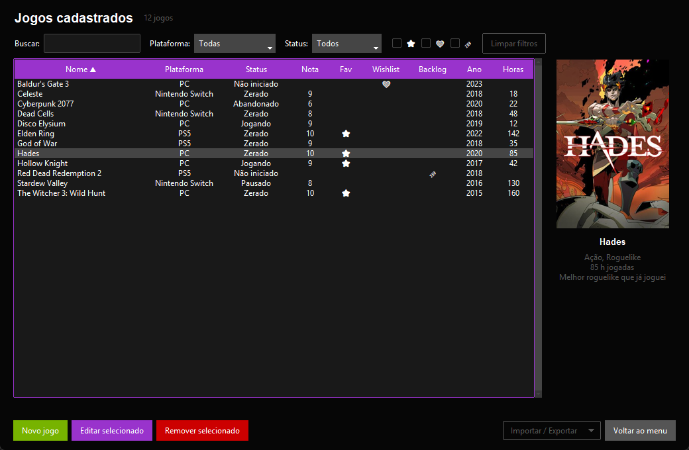
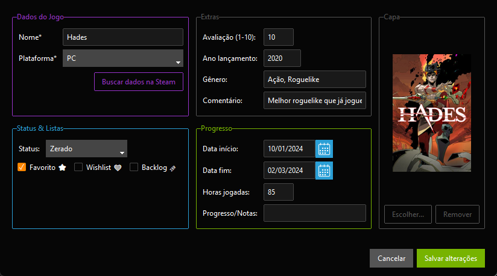
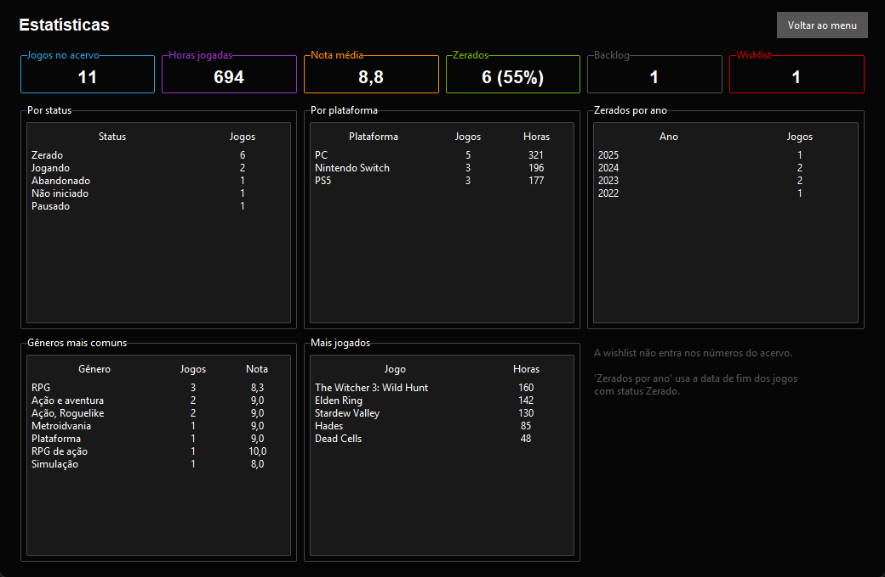
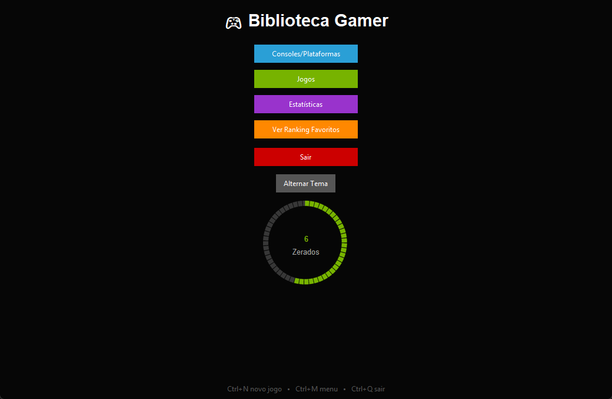

# Biblioteca Gamer

Uma aplicação desktop para gerenciar a sua coleção de jogos e consoles — rápida, fácil e expansível.

## ✨ Funcionalidades

- Cadastro, renomeação e remoção de consoles/plataformas.
- Cadastro, edição e remoção de jogos, com plataforma, status, nota, ano, gênero, datas, horas jogadas e comentários.
- Listas de favoritos ⭐, wishlist ❤️ e backlog 🔖.
- Tabela com busca por nome, filtros por plataforma, status e listas, e ordenação ao clicar no cabeçalho.
- Capa de cada jogo, mostrada ao lado da lista.
- Preenchimento automático de ano, gênero e capa pela loja da Steam.
- Importação da biblioteca de uma conta Steam, com as horas jogadas.
- Tela de estatísticas: horas por plataforma, zerados por ano, gêneros, jogos mais jogados.
- Ranking dos 5 favoritos mais bem avaliados e barra de progresso dos jogos zerados.
- Backup automático do banco ao fechar, e exportação/importação em CSV.
- Quatro temas visuais; o app lembra o último escolhido.

## Telas

As imagens usam uma coleção de exemplo.

**Formulário do jogo** — cadastro e edição, com o botão que busca ano, gênero e capa na Steam.

**Estatísticas** — totais do acervo e tabelas por status, plataforma, ano, gênero e horas.

**Menu principal** — acesso às telas e progresso dos jogos zerados.

## Como rodar

Pré-requisitos: Python 3.10+ (https://python.org/) com pip.

1. Clone o projeto:

       git clone https://github.com/KawanVictor/Biblioteca_Gamer.git
       cd Biblioteca_Gamer

2. Crie o ambiente virtual e instale as dependências:

       python -m venv venv
       venv\Scripts\activate
       pip install -r requirements.txt

3. Execute o app:

       python main.py

💡 Cadastre ao menos um console antes de adicionar jogos.

### Gerar o executável (.exe)

Com o ambiente virtual ativado, rode `gerar_exe.bat`. O resultado é `dist\BibliotecaGamer.exe`, que abre com dois cliques e não precisa de Python instalado.

## Como usar

No menu principal, escolha:

- **Consoles/Plataformas:** cadastre plataformas (ex.: PC, Xbox, PS5...). Duplo clique renomeia; remover uma plataforma apaga também os jogos dela.
- **Jogos:** use "Novo jogo" para cadastrar. Duplo clique em uma linha (ou "Editar selecionado") abre o jogo para edição.
- **Estatísticas:** números do acervo (a wishlist fica de fora).
- **Alternar Tema:** troca entre os temas disponíveis.

Atalhos de teclado:

| Atalho | Ação |
| --- | --- |
| Ctrl+N | Novo jogo |
| Ctrl+F | Ir para a busca (tela de jogos) |
| Enter | Editar o jogo selecionado / salvar o formulário |
| Delete | Remover o item selecionado |
| Esc | Fechar o formulário |
| Ctrl+M | Voltar ao menu |
| Ctrl+Q | Sair |

### Steam

- **Buscar dados na Steam** (no formulário do jogo): digite o nome e clique no botão. O app preenche ano, gênero e capa, sem sobrescrever o que você já digitou. Não precisa de conta nem de chave.
- **Importar biblioteca da Steam** (botão "Importar / Exportar" da tela de jogos): traz todos os jogos da conta com as horas jogadas. Rodar de novo só atualiza as horas, sem duplicar. Você precisa de:
  - uma chave da API, criada em https://steamcommunity.com/dev/apikey;
  - o seu SteamID de 17 números (steamID64);
  - a opção "Detalhes dos jogos" como pública na privacidade do perfil.

  A chave fica guardada no banco local para não precisar digitar de novo, protegida pelo Windows (DPAPI): só o seu usuário, nesta máquina, consegue lê-la. Se o banco for copiado para outro computador, o app pede a chave de novo. Fora do Windows não há essa proteção, então a chave não é guardada.

Jogos que têm vínculo com a Steam e estão sem capa têm a capa baixada quando são selecionados na lista.

## Seus dados

Tudo fica em uma pasta só:

| Item | Onde |
| --- | --- |
| Banco | `biblioteca_gamer.db` |
| Capas | `capas\` |
| Backups automáticos | `backups\` (os 10 mais recentes) |

Essa pasta é a do projeto quando você roda `python main.py`, e `%APPDATA%\BibliotecaGamer` quando usa o `.exe`. Para usar outro lugar (uma pasta do OneDrive, por exemplo), defina a variável de ambiente `BIBLIOTECA_GAMER_DADOS` com o caminho.

Nada disso é enviado para o GitHub. Ao fechar, o app guarda uma cópia do banco em `backups\` se algo mudou. Para restaurar, feche o app e copie o backup desejado por cima de `biblioteca_gamer.db`. As capas não entram no backup.

"Exportar CSV" gera uma planilha com todos os jogos; "Importar CSV" lê o mesmo formato, cria as plataformas que faltarem e pula os jogos que já existem.

Ao abrir um banco criado por uma versão anterior do app, ele é atualizado automaticamente e uma cópia do original fica ao lado dele (`biblioteca_gamer.backup-v0.db`, por exemplo).

## Estrutura

- `main.py` — ponto de entrada.
- `views/` — interface, um módulo por tela: `menu.py`, `consoles.py`, `jogos.py` (lista), `formulario.py`, `importar_steam.py` e `estatisticas.py`. `base.py` tem o que as telas compartilham e `ui.py` cria a janela.
- `controllers/controller.py` — validações, regras, capas e CSV.
- `controllers/steam.py` — consultas à Steam.
- `controllers/segredo.py` — proteção da chave da Steam.
- `database/db.py` — esquema, migrações, backup e consultas SQLite.
- `assets/` — ícone do app (`gerar_icone.py` redesenha o `.ico`).
- `docs/imagens/` — capturas de tela usadas neste README.
- `tests/` — testes automatizados. Rode com `python -m unittest` na raiz do projeto; eles não usam a internet nem o seu banco.

## Tecnologias

- Python 3.10+
- Tkinter com ttkbootstrap 1.14 (interface estilizada)
- Pillow (capas)
- SQLite (persistência local e leve)
